# Algo Pro — Quant Trading System (Indian Market)

Automated, risk-gated quantum of work for NSE/BSE trading: data → features → signal →
conviction → sizing → portfolio risk → session guards → **risk gate** → execution → ledger,
with a feedback loop back into research.

- **Design source of truth:** [`docs/quant_system_flow_v5.md`](docs/quant_system_flow_v5.md) + [`quant_system_flow_v5.svg`](quant_system_flow_v5.svg)
- **Build order:** [`docs/IMPLEMENTATION_PLAN.md`](docs/IMPLEMENTATION_PLAN.md)
- **Operating procedure:** [`docs/My_trading_system_SOP/SOP.md`](docs/My_trading_system_SOP/SOP.md)

> **Status: proposed design, not live.** Every module under `src/quant/` is a scaffold
> (~5 lines, `Status: SCAFFOLD`). Working code lives in `Blue_engine/`. No stage in the
> v5 flow is production-live until its code, unit tests and exit checks pass.

---

## System flow v5


*(Rendered inline by GitHub from the SVG at repo root. Diagram is 1530 × 1935 px.)*

**Legend**

| Mark | Meaning |
|---|---|
| Solid gray arrow | Normal trade-path flow |
| Dashed red arrow | Feedback loop and kill switch |
| Dashed purple arrow | Approved-model handoff only (model registry → factor models) |
| Gray box | State, inputs, governance |
| Purple box | Analysis and AI (advice only) |
| Green box | Decision and execution |
| Red box | Safety and gates |

**Two hard rules**

1. Every order intent passes the **Risk gate**. No other stage can reach OpenAlgo.
2. No AI/LLM stage has a trade path. Event scoring is advice only.

---

## Trade path (simplified)

```mermaid
flowchart LR
    A[Data QA + features] --> B[Signal + meta-labeler]
    B --> C[Calibrated conviction]
    C --> D[Fractional Kelly + allocator]
    D --> E[Portfolio risk + stress]
    E --> F[Session guards]
    F --> G[Pre-trade + liquidity checks]
    G --> H{Risk gate}
    H -->|pass| I[Order queue + router]
    I --> J[OpenAlgo]
    J --> K[Ledger + recon]
    K --> L[TCA + strategy health]
    L -->|breach| M[Kill switch] -.-> H
```



---

## Repository layout

```
Algo Pro/
├── quant_system_flow_v5.svg     # architecture diagram (source of truth)
├── src/quant/                   # v5 flow scaffolding — one package per lane
│   ├── core/                    #   shared types, config loader, clock, logging
│   ├── research/                #   backtest, walk-forward, DSR/PBO, trial log,
│   │                            #   costs, capacity, lineage
│   ├── models/                  #   regime, factors, signal, meta-label,
│   │                            #   calibration, events (advice only)
│   ├── portfolio/               #   sizing, allocator, covariance, HRP optimizer,
│   │                            #   rebalance, portfolio risk
│   ├── risk/                    #   gate, pretrade, price band, liquidity,
│   │                            #   loss breaker, kill switch, controls, exits,
│   │                            #   squareoff            ← only path to orders
│   ├── execution/               #   queue, router, order FSM, OpenAlgo client,
│   │                            #   protection
│   ├── monitor/                 #   ledger, TCA, live monitor, strategy health,
│   │                            #   drift, parity, safe mode, throttle, session
│   ├── feedback/                #   champion/challenger, re-optimization
│   ├── audit/                   #   append-only audit log, override log
│   ├── reporting/               #   dashboard data, accounting (P&L gated)
│   └── notify/                  #   alerts by severity
├── Blue_engine/                 # existing working engine (405 files, 84 tests)
│   ├── core/                    #   runner, risk_gate, supervisor, exit_engine,
│   │                            #   paper_broker, ledger, client, broker_auth
│   ├── backtest/                #   engine, loops, costs, blueprints
│   ├── portfolio/               #   optimizer, risk models, optim_policy
│   ├── economics/               #   regime, providers, event calendar, LLM scorer
│   ├── screener/ sectors/       #   frontline screening engines
│   ├── alpha/ market/ ml/       #   factors, market data, models + registry
│   ├── pov/                     #   POV execution + state machine
│   ├── dashboard/               #   operations dashboard (app.py)
│   ├── database/ infrastructure/ jobs/ optimizer/
│   ├── skills/                  #   per-stage agent skill docs
│   └── tests/                   #   engine test suite
├── strategies/                  # strategy classes, registered by name
├── config/                      # settings, risk_limits, strategies/, calendar/
├── scripts/                     # planned: run_backtest.py, run_paper.py,
│                                #   run_live.py + run/ verify/ research/ train/ ops/
├── dashboard/                   # dashboard UI assets
├── Servers/                     # platform services (OpenAlgo, dashboard)
├── tests/                       # unit / integration / replay / fixtures
├── docs/                        # flow doc, plan, SOP, decisions, audits
└── rules/ patches/              # project rules and upstream patches
```

**Lane → package map**

| Flow lane | Package |
|---|---|
| Research validation | `src/quant/research/` |
| Market inputs | `src/quant/data/market_inputs.py` — **not scaffolded yet** |
| Data and features | `src/quant/data/` — **not scaffolded yet** (planned for Phase 1) |
| Signal and conviction | `src/quant/models/` |
| Sizing and portfolio | `src/quant/portfolio/` |
| Portfolio risk, session guards, safety gate | `src/quant/risk/` |
| Execution | `src/quant/execution/` |
| Post-trade | `src/quant/monitor/` |
| Audit | `src/quant/audit/` |
| Improvement loop | `src/quant/feedback/` |
| Support, dashboard, alerts | `src/quant/monitor/`, `src/quant/reporting/`, `src/quant/notify/` |

---

## Implementation phases

| Phase | Scope | Capital |
|---|---|---|
| 0 | Reuse audit of `Blue_engine/`, test baseline, trust boundary | none |
| 1 | Safe foundation: data, research, risk gate, queue, ledger, paper runner | none |
| 2 | Signal, conviction, sizing, portfolio, model registry | none (paper) |
| 3 | Live execution, session guards, monitors, dashboard, alerts | small, fixed cap |
| 4 | Improvement loop, recovery, hardening, docs sync | capped |

Hard rule: no phase starts before the previous phase's exit checks pass. Details in
[`docs/IMPLEMENTATION_PLAN.md`](docs/IMPLEMENTATION_PLAN.md).

---

## Quick start

```powershell
# install
.\install.bat

# paper session (full path, no broker orders)
.venv\Scripts\python.exe -m blue_engine.core.runner Blue_engine/input/master.json --paper

# supervised run (six safety gates before every start)
.venv\Scripts\python.exe scripts\run\run_supervised.py

# engine tests
.venv\Scripts\python.exe -m pytest Blue_engine/tests
```

OpenAlgo must be reachable on `127.0.0.1:5000` before any live or paper session that
uses real quotes. See the SOP pre-session checklist for the full gating list.

---

## Non-negotiables

- **Capital protection → data integrity → risk control → execution integrity → system
  stability → strategy performance → optimization.** In that order, always.
- Only `src/quant/execution/openalgo_client.py` may call the broker order API.
  Enforced by `tests/unit/test_layout.py`.
- Simulated, backtested or estimated data is never presented as live.
- `config/risk_limits.yaml` values are `null` on purpose. Live trading stays blocked
  until a human sets them.

---

## Documentation

| Document | Purpose |
|---|---|
| [`docs/quant_system_flow_v5.md`](docs/quant_system_flow_v5.md) | Flow stages by lane |
| [`docs/IMPLEMENTATION_PLAN.md`](docs/IMPLEMENTATION_PLAN.md) | Phases, reuse map, exit checks |
| [`docs/My_trading_system_SOP/SOP.md`](docs/My_trading_system_SOP/SOP.md) | Pre-session checklist, operations |
| [`docs/Economic_to_POV_Pipeline_Audit_2026-10-22.md`](docs/Economic_to_POV_Pipeline_Audit_2026-10-22.md) | Pipeline audit |
| [`docs/ML_SKILL_DIAGNOSIS.md`](docs/ML_SKILL_DIAGNOSIS.md) | ML stage diagnosis |
| [`docs/decisions/`](docs/decisions/) | One note per design decision |
| [`AGENTS.md`](AGENTS.md) | Engineering rules for this repo |
| [`INSTALL.md`](INSTALL.md) | Environment setup |
