# Algo Pro — Quant Trading System (Indian Market)


## Trade path (simplified)

```mermaid
flowchart LR
    A[Data QA + features] --> B[Signal + meta-labeler]
    B --> C[Calibrated conviction]
    C --> D[Fractional Kelly + allocator]
    D --> E[Portfolio risk + stress]
    E --> F[Session guards]
    F --> G[Pre-trade + liquidity checks]
    G --> H{Risk gate}
    H -->|pass| I[Order queue + router]
    I --> J[OpenAlgo]
    J --> K[Ledger + recon]
    K --> L[TCA + strategy health]
    L -->|breach| M[Kill switch] -.-> H
```



---

## Repository layout

```
Algo-Pro/
├── README.md                    # entry point: status, quick start, doc links
├── AGENTS.md                    # engineering rules for this repo
├── INSTALL.md                   # environment setup
├── requirements.txt             # Python dependencies
├── pyproject.toml               # package metadata and pytest config
├── .env.example                 # template only; real .env is gitignored
├── .gitignore  .gitattributes  .gitmodules
├── install.bat                  # Windows install / update / start script
├── openalgo.UPSTREAM_PIN        # pinned upstream OpenAlgo version
├── quant_system_flow_v5.svg     # system flow diagram
│
├── config/                      # runtime configuration (YAML + calendars)
│   ├── settings.yaml
│   ├── risk_limits.yaml         # values stay null until a human sets them
│   ├── conviction_tiers.yaml    # position-sizing tiers by conviction
│   ├── data_sources.yaml
│   ├── strategies/              # one YAML per strategy
│   └── calendar/                # holidays.csv (loader), nse_holidays_2026.csv (reference)
│
├── src/quant/                   # core trading code package
│   ├── core/                    # types, config loader, clock, logging, db, calendar, expiry/lot rules
│   ├── data/                    # market inputs, providers, feature store, QA
│   ├── models/                  # regime, factors, signal, meta-label, calibration
│   │   └── events/              # LLM/event scoring (advice only, never on trade path)
│   ├── strategies/              # strategy classes, registered by name
│   ├── portfolio/               # sizing, Kelly, allocator, covariance, HRP, rebalance
│   ├── risk/                    # gate (only path to orders), pretrade, liquidity,
│   │                            #   money checks, loss breaker, kill switch, exits, squareoff
│   ├── execution/               # order queue, router, FSM, OpenAlgo client, POV
│   ├── research/                # backtest, walk-forward, DSR/PBO, trial log, costs
│   ├── monitor/                 # ledger, TCA, strategy health, drift, session
│   ├── feedback/                # champion/challenger, re-optimization
│   ├── audit/                   # append-only audit and override logs
│   ├── reporting/               # dashboard data, accounting (P&L-gated view)
│   ├── notify/                  # alerts by severity
│   ├── openalgo_platform/       # OpenAlgo integration layer
│   ├── vendor/                  # vendored third-party code
│   └── tests/                   # package-level tests
│
├── Blue_engine/                 # earlier engine package; still used by Quick start commands
│   ├── alpha/  backtest/  configs/  core/  database/  economics/
│   ├── infrastructure/  input/  jobs/  market/  ml/  optimizer/
│   ├── portfolio/  pov/  screener/  sectors/  tests/
│   └── valuation_engine.py  runtime_paths.py  pyproject.toml  README.md
│
├── scripts/                     # entry points: run, research, train, ops
│   ├── run/                     # run_paper.py, run_live.py, run_supervised.py
│   ├── research/                # backtest and optimization helpers
│   ├── train/                   # model training
│   ├── ops/                     # maintenance, recon
│   ├── diagnostics/  verify/    # diagnostic and verification tools
│   └── run_backtest.py  run_paper.py  run_pov.py  smoke_test.py  ...
│
├── dashboard/                   # the one dashboard
│   ├── app.py                   # FastAPI app
│   ├── main_dashboard.html
│   └── assets/
│
├── Servers/                     # Ubuntu server setup and launch
│   ├── install_ubuntu.sh
│   ├── launch_ubuntu_server.sh
│   ├── provision_desktop_remote.sh
│   ├── DEPLOY_UBUNTU.md
│   └── deploy.env.example
│
├── tests/                       # repo-level test suite
│   ├── conftest.py
│   ├── unit/                    # includes test_layout.py (order-path rule)
│   ├── integration/
│   ├── parity/                  # money-check parity tests
│   ├── replay/
│   └── fixtures/
│
├── docs/                        # plans, status notes, audits, decisions
│   ├── quant_system_flow_v5.md
│   ├── IMPLEMENTATION_PLAN*.md  # phase plans (dated where applicable)
│   ├── STATUS_*.md              # dated status snapshots
│   ├── My_trading_system_SOP/   # SOP and pre-session checklist
│   ├── audits/                  # dated audit reports
│   ├── decisions/               # one note per design decision
│   ├── compliance/
│   ├── skills/                  # per-stage agent skill docs
│   └── images/
│
├── rules/                       # project rules (e.g. token-optimization.md)
├── patches/                     # patches applied to upstream OpenAlgo
└── Temp/                        # git submodule: openalgo-python-library
```

**Lane → package map**

| Flow lane | Package |
|---|---|
| Research validation | `src/quant/research/` |
| Market inputs | `src/quant/data/market_inputs.py` |
| Data and features | `src/quant/data/` |
| Signal and conviction | `src/quant/models/` |
| Sizing and portfolio | `src/quant/portfolio/` |
| Portfolio risk, session guards, safety gate | `src/quant/risk/` |
| Execution | `src/quant/execution/` |
| Post-trade | `src/quant/monitor/` |
| Audit | `src/quant/audit/` |
| Improvement loop | `src/quant/feedback/` |
| Support, dashboard, alerts | `src/quant/monitor/`, `src/quant/reporting/`, `src/quant/notify/` |

---


---

## Quick start

```powershell
# install
.\install.bat

# paper session (full path, no broker orders)
.venv\Scripts\python.exe -m blue_engine.core.runner Blue_engine/input/master.json --paper

# supervised run (six safety gates before every start)
.venv\Scripts\python.exe scripts\run\run_supervised.py

# engine tests
.venv\Scripts\python.exe -m pytest Blue_engine/tests
```

OpenAlgo must be reachable on `127.0.0.1:5000` before any live or paper session that
uses real quotes. See the SOP pre-session checklist for the full gating list.

---

## Non-negotiables

- **Capital protection → data integrity → risk control → execution integrity → system
  stability → strategy performance → optimization.** In that order, always.
- Only `src/quant/execution/openalgo_client.py` may call the broker order API.
  Enforced by `tests/unit/test_layout.py`.
- Simulated, backtested or estimated data is never presented as live.
- `config/risk_limits.yaml` values are `null` on purpose. Live trading stays blocked
  until a human sets them.

---

## Documentation

| Document | Purpose |
|---|---|
| [`docs/quant_system_flow_v5.md`](docs/quant_system_flow_v5.md) | Flow stages by lane |
| [`docs/IMPLEMENTATION_PLAN.md`](docs/IMPLEMENTATION_PLAN.md) | Phases, reuse map, exit checks |
| [`docs/My_trading_system_SOP/SOP.md`](docs/My_trading_system_SOP/SOP.md) | Pre-session checklist, operations |
| [`docs/audits/Economic_to_POV_Pipeline_Audit_2026-10-22.md`](docs/audits/Economic_to_POV_Pipeline_Audit_2026-10-22.md) | Pipeline audit |
| [`docs/audits/ML_SKILL_DIAGNOSIS.md`](docs/audits/ML_SKILL_DIAGNOSIS.md) | ML stage diagnosis |
| [`docs/decisions/`](docs/decisions/) | One note per design decision |
| [`AGENTS.md`](AGENTS.md) | Engineering rules for this repo |
| [`INSTALL.md`](INSTALL.md) | Environment setup |
