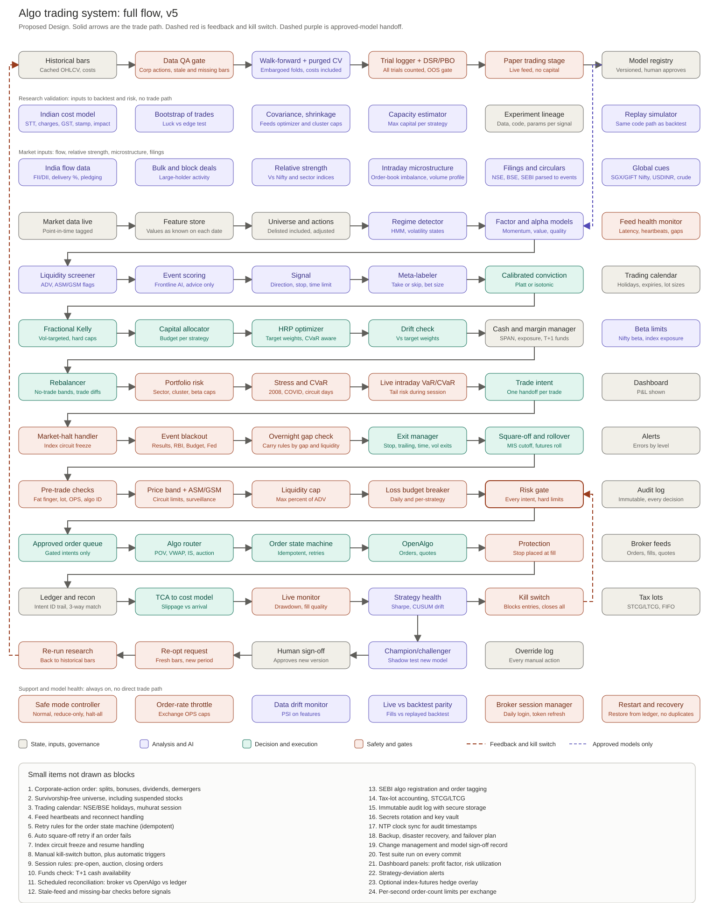

# Algo Pro — Quant Trading System (Indian Market)

Automated, risk-gated quantum of work for NSE/BSE trading: data → features → signal →
conviction → sizing → portfolio risk → session guards → **risk gate** → execution → ledger,
with a feedback loop back into research.

- **Design source of truth:** [`docs/quant_system_flow_v5.md`](docs/quant_system_flow_v5.md) + [`quant_system_flow_v5.svg`](quant_system_flow_v5.svg)
- **Build order:** [`docs/IMPLEMENTATION_PLAN.md`](docs/IMPLEMENTATION_PLAN.md)
- **Operating procedure:** [`docs/My_trading_system_SOP/SOP.md`](docs/My_trading_system_SOP/SOP.md)

> **Status (2026-11-06): paper and research only. Nothing is live.** Most `src/quant/` modules
> now carry code and unit tests (`Status: PHASE n IMPLEMENTED`). The live path (Phase 3 runner,
> broker feed, router) is not enabled. No stage is production-live until its exit checks pass.
> Latest state: [`docs/STATUS_2026-11-06.md`](docs/STATUS_2026-11-06.md).

## Current status (2026-11-06)

| Area | State |
|---|---|
| Trading-day calendar | 2026 NSE equity holidays from official circulars (NSE/CMTR/71775 + circular 07/2026): 16 weekdays. Loader: `config/calendar/holidays.csv`. Reference with sources: `config/calendar/nse_holidays_2026.csv`. |
| Expiry and lot size | Delivery: no expiry. Intraday: same-day expiry. Lot size only for SME, read from the broker at order time; whole lots only; fail closed. `src/quant/core/expiry_rules.py`. |
| Costs | Indian cost model; exchange charge 0.00307% per side (NSE circular FA73061). Hand-checked tests. |
| Risk limits | Starter minimums approved for paper. Live values = same values; live still blocked. `config/risk_limits.yaml`. |
| Model registry | Human sign-off required before promotion. `src/quant/feedback/champion_challenger.py`. |
| Dashboard | FastAPI, read-only. P&L shown by default. |
| Tests | Sandbox: `pytest tests/unit` 27 failed, 424 passed, 18 skipped. All 27 failures are the missing `httpx` package (HRP via Blue bridge). `pytest tests/parity` passes, including the money-check parity (34,560 cases, zero differences). Owner machine run pending. |
| Risk money checks | Ported out of Blue_engine (decision 0018). `src/quant/risk/money_checks.py`. Owner sign-off pending. |
| Live order guard | Live orders need a human `LiveApproval` tied to the current risk limits file, and an approved gate decision for the same intent. Still not enabled. `src/quant/execution/openalgo_client.py`. |
| Data | INFY is test-only (`config/data_sources.yaml`). Fetched on the owner machine with `python Blue_engine/database/sample_data.py`. Not in this repo. No live data source is chosen yet. |

**Next steps and owner follow-ups:** see [`docs/IMPLEMENTATION_PLAN.md`](docs/IMPLEMENTATION_PLAN.md), section "Follow-ups after 2026-11-06".
**Decisions:** [`docs/decisions/`](docs/decisions/) (0015 owner answers, 0016 lots, calendar, live limits).

---

## System flow v5



*(Rendered inline by GitHub from the SVG at repo root. Diagram is 1530 × 1935 px.)*

**Legend**

| Mark | Meaning |
|---|---|
| Solid gray arrow | Normal trade-path flow |
| Dashed red arrow | Feedback loop and kill switch |
| Dashed purple arrow | Approved-model handoff only (model registry → factor models) |
| Gray box | State, inputs, governance |
| Purple box | Analysis and AI (advice only) |
| Green box | Decision and execution |
| Red box | Safety and gates |

**Two hard rules**

1. Every order intent passes the **Risk gate**. No other stage can reach OpenAlgo.
2. No AI/LLM stage has a trade path. Event scoring is advice only.

---

## Trade path (simplified)

```mermaid
flowchart LR
    A[Data QA + features] --> B[Signal + meta-labeler]
    B --> C[Calibrated conviction]
    C --> D[Fractional Kelly + allocator]
    D --> E[Portfolio risk + stress]
    E --> F[Session guards]
    F --> G[Pre-trade + liquidity checks]
    G --> H{Risk gate}
    H -->|pass| I[Order queue + router]
    I --> J[OpenAlgo]
    J --> K[Ledger + recon]
    K --> L[TCA + strategy health]
    L -->|breach| M[Kill switch] -.-> H
```



---

## Repository layout

`Algo-Pro/
├── README.md                    # entry point: status, quick start, doc links
├── AGENTS.md                    # engineering rules (keep)
├── INSTALL.md
├── requirements.txt
├── pyproject.toml               # package metadata, pytest config (new, replaces ad-hoc setup)
├── .env.example                 # template only; real .env is gitignored
├── .gitignore  .gitattributes  .gitmodules
├── install.sh  install.bat
│
├── config/
│   ├── settings.yaml
│   ├── risk_limits.yaml         # values stay null until a human sets them
│   ├── strategies/              # one YAML per strategy
│   └── calendar/                # NSE holidays (holidays.csv = loader; nse_holidays_2026.csv = reference)
│
├── src/quant/                   # ALL trading code lives here
│   ├── core/                    # types, config loader, clock, logging, db helpers, calendar, expiry/lot rules
│   ├── data/                    # market inputs, providers, feature store, QA
│   ├── models/                  # regime, factors, signal, meta-label, calibration
│   │   └── events/              # LLM/event scoring (advice only, never on trade path)
│   ├── strategies/              # strategy classes, registered by name
│   ├── portfolio/               # sizing, Kelly, allocator, covariance, HRP, rebalance
│   ├── risk/                    # gate (only path to orders), pretrade, liquidity,
│   │                            #   loss breaker, kill switch, exits, squareoff
│   ├── execution/               # order queue, router, FSM, OpenAlgo client, POV
│   ├── research/                # backtest, walk-forward, DSR/PBO, trial log, costs
│   ├── monitor/                 # ledger, TCA, strategy health, drift, session
│   ├── feedback/                # champion/challenger, re-optimization
│   ├── audit/                   # append-only audit and override logs
│   ├── reporting/               # dashboard data, accounting (P&L-gated view)
│   └── notify/                  # alerts by severity
│
├── scripts/
│   ├── run/                     # run_paper.py, run_live.py, run_supervised.py
│   ├── research/                # backtest, optimize
│   ├── train/                   # model training
│   └── ops/                     # maintenance, recon
│
├── dashboard/                   # the ONE dashboard (app.py + assets)
│
├── tests/
│   ├── unit/                    # includes test_layout.py (order-path rule)
│   ├── integration/
│   ├── replay/
│   └── fixtures/
│
├── docs/
│   ├── quant_system_flow_v5.md  + .svg
│   ├── IMPLEMENTATION_PLAN.md
│   ├── SOP.md
│   ├── decisions/               # one note per design decision
│   ├── audits/                  # dated audit reports
│   └── skills/                  # per-stage agent skill docs (moved from Blue_engine)
│
├── rules/                       # project rules
└── patches/                     # upstream OpenAlgo patches

**Lane → package map**

| Flow lane | Package |
|---|---|
| Research validation | `src/quant/research/` |
| Market inputs | `src/quant/data/market_inputs.py` |
| Data and features | `src/quant/data/` |
| Signal and conviction | `src/quant/models/` |
| Sizing and portfolio | `src/quant/portfolio/` |
| Portfolio risk, session guards, safety gate | `src/quant/risk/` |
| Execution | `src/quant/execution/` |
| Post-trade | `src/quant/monitor/` |
| Audit | `src/quant/audit/` |
| Improvement loop | `src/quant/feedback/` |
| Support, dashboard, alerts | `src/quant/monitor/`, `src/quant/reporting/`, `src/quant/notify/` |

---

## Implementation phases

| Phase | Scope | Capital |
|---|---|---|
| 0 | Reuse audit of `Blue_engine/`, test baseline, trust boundary | none |
| 1 | Safe foundation: data, research, risk gate, queue, ledger, paper runner | none |
| 2 | Signal, conviction, sizing, portfolio, model registry | none (paper) |
| 3 | Live execution, session guards, monitors, dashboard, alerts | small, fixed cap |
| 4 | Improvement loop, recovery, hardening, docs sync | capped |

Hard rule: no phase starts before the previous phase's exit checks pass. Details in
[`docs/IMPLEMENTATION_PLAN.md`](docs/IMPLEMENTATION_PLAN.md).

---

## Quick start

```powershell
# install
.\install.bat

# paper session (full path, no broker orders)
.venv\Scripts\python.exe -m blue_engine.core.runner Blue_engine/input/master.json --paper

# supervised run (six safety gates before every start)
.venv\Scripts\python.exe scripts\run\run_supervised.py

# engine tests
.venv\Scripts\python.exe -m pytest Blue_engine/tests
```

OpenAlgo must be reachable on `127.0.0.1:5000` before any live or paper session that
uses real quotes. See the SOP pre-session checklist for the full gating list.

---

## Non-negotiables

- **Capital protection → data integrity → risk control → execution integrity → system
  stability → strategy performance → optimization.** In that order, always.
- Only `src/quant/execution/openalgo_client.py` may call the broker order API.
  Enforced by `tests/unit/test_layout.py`.
- Simulated, backtested or estimated data is never presented as live.
- `config/risk_limits.yaml` values are `null` on purpose. Live trading stays blocked
  until a human sets them.

---

## Documentation

| Document | Purpose |
|---|---|
| [`docs/quant_system_flow_v5.md`](docs/quant_system_flow_v5.md) | Flow stages by lane |
| [`docs/IMPLEMENTATION_PLAN.md`](docs/IMPLEMENTATION_PLAN.md) | Phases, reuse map, exit checks |
| [`docs/My_trading_system_SOP/SOP.md`](docs/My_trading_system_SOP/SOP.md) | Pre-session checklist, operations |
| [`docs/audits/Economic_to_POV_Pipeline_Audit_2026-10-22.md`](docs/audits/Economic_to_POV_Pipeline_Audit_2026-10-22.md) | Pipeline audit |
| [`docs/audits/ML_SKILL_DIAGNOSIS.md`](docs/audits/ML_SKILL_DIAGNOSIS.md) | ML stage diagnosis |
| [`docs/decisions/`](docs/decisions/) | One note per design decision |
| [`AGENTS.md`](AGENTS.md) | Engineering rules for this repo |
| [`INSTALL.md`](INSTALL.md) | Environment setup |
