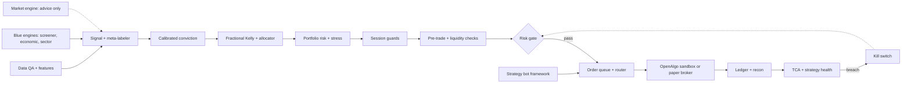

# Quant System Flow v5 (Design)

**Status (2026-11-14): all ten lanes implemented as code and tests. Stage-by-stage audit
completed 2026-11-14; every lane now has a documented implementation and a blocker
where one remains. The strategy bot runs in paper or analyze (OpenAlgo sandbox) mode
only. Live mode is refused in code. The live market-data source is NOT approved
(config/data_sources.yaml), so the bot skips every cycle until the owner approves
one. Nothing is live.**

The audit found and fixed ~14 defects across the ten lanes. They shared one shape:
**they were silent.** A drift alarm that a single NaN switched off forever, sector
caps that were enforced nowhere, a holiday path that refused every entry when the
process started outside the repo root, a cost-model feedback loop that was
documented and never wired. Each is now fixed and pinned by a test.
Source diagram: `quant_system_flow_v5.svg` (repo root).

Legend:
- Solid gray arrow: normal flow.
- Dashed red arrow: feedback and kill switch.
- Dashed purple arrow: approved-model handoff only.

---

## 1. Big picture

The system has two paths.

**Trade path (left to right, top to bottom):**
Data → Features → Signal → Conviction → Sizing → Portfolio risk → Session guards → Safety gate → Execution → Ledger.

**Improvement path (feedback):**
Post-trade monitoring → Re-run research → Human sign-off → Model registry → back into the trade path.

**Two hard rules:**
1. Every order intent passes the **Risk gate**. No other stage can reach OpenAlgo.
2. No AI or LLM stage has a trade path. Event scoring is advice only.

---

## 2. Stages by lane

Stages follow the snake order of the SVG: each row runs left to right, then the flow drops to the start of the next row.

### 2.1 Research validation (no trade path)

| Stage | What it does |
|---|---|
| Historical bars | Cached OHLCV and cost data |
| Data QA gate | `data/qa.py`. `check_bars` (DataFrame, unchanged contract) now also reports calendar gaps; `audit_bars` runs the engine's eight checks - gaps, insufficient history, per-column missing fraction, staleness, price sanity. Failure stops the run |
| Walk-forward + purged CV | Embargoed folds, costs included (`research/walk_forward.py` splits, `research/walk_forward_eval.py` fitted/scored, deflated) |
| Trial logger + DSR/PBO | Counts every trial tried. Out-of-sample gate |
| Paper trading stage | Live feed, no capital |

Support inputs to backtest and risk:

| Stage | What it does |
|---|---|
| Indian cost model | STT, brokerage, exchange charges, GST, stamp duty, market impact |
| Bootstrap of trades | Luck vs edge test |
| Covariance + shrinkage | Feeds the optimizer and cluster caps |
| Capacity estimator | `research/capacity.py`. Inverse of the engine's square-root impact law, not a linear multiple of ADV: capacity is where impact consumes the edge |
| Experiment lineage | `research/lineage.py`. Data hash, param hash, commit, plus cost-model version, horizon, universe, date range and dirty-tree state; `verify_lineage` re-checks a stored row |

### 2.2 Market inputs

| Stage | What it does |
|---|---|
| India flow data | FII/DII flows, delivery %, promoter pledging |
| Bulk and block deals | Large-holder activity |
| Relative strength | Stock vs Nifty and sector indices |
| Intraday microstructure | Order-book imbalance, volume profile |
| Filings and circulars | NSE, BSE and SEBI documents parsed into events |
| Live bars and daily stats | Read-only OpenAlgo history: closed intraday bars for signals, ADV and previous close from days before today. Returns nothing when the feed is stale, errored or too short (`data/live_bars.py`). |
| Screener engine | Blue screener: fail-closed symbol gate. Feeds the liquidity screener and the screen file |
| Economic engine | Macro risk-on score. Its risk multiplier is clamped to 0.5 to 1.0, so a stale feed cannot lever up |
| Market engine | Blue market picture: indices, commodities, FII inflow. Advice only. No market data gives an unknown state, never a neutral one (`data/market_engine.py`) |
| Sector engine | Sector index scores. Short history gives no score, never a made-up one |
| Screen input | Screener output file (`data/screened/latest.json`). Only fresh, selected, non-ASM symbols with a known circuit limit pass. Missing or stale file means no symbols. |

### 2.3 Data and features

| Stage | What it does |
|---|---|
| Market data live | Point-in-time tagged |
| Feature store | Values as known on each date (no leakage) |
| Universe and actions | Delisted stocks included, prices adjusted |
| Regime detector | HMM and volatility states |
| Factor and alpha models | Momentum, value, quality |

### 2.4 Signal and conviction

| Stage | What it does |
|---|---|
| Liquidity screener | ADV and ASM/GSM flags |
| Event scoring | Frontline AI, optional. Keyword fallback when no LLM. Advice only, no orders |
| Signal | Direction, stop, time limit |
| Meta-labeler | Take or skip, bet size |
| Calibrated conviction | Platt or isotonic calibration |

### 2.5 Sizing and portfolio

| Stage | What it does |
|---|---|
| Fractional Kelly | Volatility-targeted, hard caps |
| Capital allocator | Budget per strategy |
| HRP optimizer | Target weights, CVaR aware |
| Drift check | Current weights vs target |
| Cash and margin manager | SPAN margin, exposure, T+1 funds |
| Rebalancer | No-trade bands, trade differences |

### 2.6 Portfolio risk

| Stage | What it does |
|---|---|
| Portfolio risk | Sector, cluster and beta caps |
| Stress and CVaR | 2008, COVID and circuit-day scenarios |
| Live intraday VaR/CVaR | Tail risk during the session |
| Trade intent | One handoff per trade |

### 2.7 Session guards

| Stage | What it does |
|---|---|
| Market-halt handler | Index circuit freeze and resume |
| Event blackout | Blocks entries around results (NSE board-meeting calendar, `event_blackout_dates`), RBI, Budget, Fed |
| Overnight gap check | Carry rules by gap size and liquidity |
| Exit manager | Stop, trailing, time and volatility exits |
| Square-off and rollover | MIS cutoff, futures roll |

### 2.8 Safety gate

| Stage | What it does |
|---|---|
| **Pre-gate safety** (`risk/pre_gate.py`, 2026-11-11) | Runs BEFORE the risk gate on every entry: trading calendar (NSE holiday CSV, fail closed), event blackout, overnight gap vs previous close, trade-intent handoff contract (ids, qty, price, side, long-only), stress/VaR of the whole book. Can only refuse. Exits bypass it |
| **Compliance gate** (`risk/compliance.py`, 2026-11-11) | Live only: audit-log storage writable with free space, NTP clock skew within limit. Any failure refuses the live order |
| Pre-trade checks | Fat finger, lot size, OPS limit, algo ID |
| Price band + ASM/GSM | Circuit limits and surveillance flags |
| Liquidity cap | Max percent of ADV |
| Loss budget breaker | Daily and per-strategy loss limits. Counters persist across restart (`execution/pnl_store.py`) and include mark-to-market of open delivery positions |
| **Risk gate** | Every intent, hard limits, including max symbols per portfolio (a new symbol is blocked at the cap; unset cap blocks new symbols). Only exit to execution |

### 2.9 Execution

| Stage | What it does |
|---|---|
| Approved order queue | Gated intents only |
| Algo router | POV, VWAP, IS, auction |
| Order state machine | Idempotent, with retries |
| Strategy bot framework (5-min cycle) | Reads the screen, runs strategies on closed bars, gates each parent at full size, then slices children each cycle through the POV executor. Modes: `paper` (simulated fills) and `analyze` (OpenAlgo sandbox). `live` is refused in code. Needs the live data source approved (`execution/strategy_bot.py`, `config/bot.yaml`). |
| OpenAlgo | Orders and quotes via the bridge |
| Protection | Stop, target, breakeven and ATR trail checked per closed bar; exits go through the gate (`execution/exit_manager.py`) |

### 2.10 Post-trade

| Stage | What it does |
|---|---|
| Ledger and recon | Intent ID trail, 3-way match. `monitor/recon3.py` compares ledger vs OpenAlgo vs broker and names WHICH leg drifted (`openalgo_stale`, `ours_missing`, `we_only`, `broker_only`, `partial_split`). Two-way (`monitor/recon_job.py`) stays for the simple ledger-vs-broker job. A leg that cannot be read makes the verdict `blocked`: an entry is never approved on a comparison that did not happen |
| TCA to cost model | Slippage vs arrival price, fed back to cost model |
| Live monitor | Drawdown and fill quality (`monitor/live_monitor.py`). MAE/MFE: an entry price of 0, an empty series and a side that is not +1/-1 are all refused rather than returning `inf` or a fake flat trade |
| Strategy health | Sharpe, CUSUM drift (`monitor/strategy_health.py`). A NaN return is SKIPPED, not treated as a zero: `min(0.0, s+nan)` is `0.0`, so a single bad mark-to-market used to reset the CUSUM and switch drift detection off permanently. A flat series reports NaN Sharpe, not 9e+16 |
| Kill switch | Blocks new entries and closes all open positions (`src/quant/risk/kill_close.py`, decision 0020). Trips by hand or automatically on a daily realized loss at `max_daily_loss` (`src/quant/risk/auto_kill.py`). Kill closes pass halt-all while the switch is on. The dashboard can trip and reset it (token, reason required, audited). The dashboard sends no orders; the paper runner does the closes on its next run |

### 2.11 Improvement loop

| Stage | What it does |
|---|---|
| Re-run research | Back to historical bars |
| Re-opt request | Fresh bars, new period |
| Human sign-off | A person approves each new version |
| Champion/challenger | Shadow-tests a new model |
| Model registry | Versioned. Human approves. Feeds factor models (purple arrow) |
| Override log | Every manual action |

### 2.12 Support (always on, no trade path)

| Stage | What it does |
|---|---|
| Safe mode controller | Normal, reduce-only, halt-all |
| Order-rate throttle | Exchange OPS caps |
| Data drift monitor | PSI on features |
| Live vs backtest parity | Fills vs replayed backtest |
| Broker session manager | Daily login, token refresh |
| Replay simulator | Same code path as backtest |
| Global cues | SGX/GIFT Nifty, USDINR, crude |
| Feed health monitor | Latency, heartbeats, gaps |
| Trading calendar | Holidays, expiries, lot sizes |
| Beta limits | Nifty beta, index exposure |
| Dashboard | Read and write. Page `/ui` (`src/quant/index.html`) reads `/api/overview` every 2 s and writes limits through `POST /api/limits`, and trips or resets the kill switch through `POST /api/kill/trip` and `POST /api/kill/reset` (token, decision 0020). `/` is the JSON index. P&L shown by default (decisions 0007, 0008; a toggle can hide it). EV, MAE/MFE and rule compliance removed. MAE/MFE feed the optimizer as parameters |
| Alerts | Errors by level |
| Audit log | Immutable, every decision |
| Broker feeds | Orders, fills, quotes |
| Tax lots | STCG/LTCG, FIFO |
| Restart and recovery | Restore from ledger, no duplicate orders |

---

## 3. Main trade path (simplified)

---

## 4. Code layout (`src/quant/`)

The layout follows the project layout in `AGENTS.md`. Each module is a scaffold until it has logic and tests.
One module can implement several blocks. Its `Flow stage:` line lists them.
`tests/unit/test_layout.py` checks that every SVG block title is mapped. Known gaps are listed there (currently none).
Existing `src/quant/blue_engine/` code is wrapped, not copied. Reuse targets are in `docs/IMPLEMENTATION_PLAN.md`.

| Flow lane | Package |
|---|---|
| Research validation | `src/quant/research/` |
| Market inputs | `src/quant/data/market_inputs.py`, `src/quant/data/live_bars.py` (read-only history, stale-feed checks) |
| Data and features | `src/quant/data/` |
| Signal and conviction | `src/quant/models/`; candle and strategy ports in `src/quant/strategies/` and `src/quant/indicators/`; signal-to-intent adapter `src/quant/strategies/signals/risk_adapter.py` |
| Sizing and portfolio | `src/quant/portfolio/` |
| Portfolio risk, session guards, safety gate | `src/quant/risk/` |
| Execution | `src/quant/execution/` (includes `strategy_bot.py`: 5-min bot, paper and analyze only) |
| Post-trade | `src/quant/monitor/` |
| Audit | `src/quant/audit/` |
| Improvement loop | `src/quant/feedback/` |
| Support, dashboard, alerts | `src/quant/monitor/`, `src/quant/reporting/`, `src/quant/notify/` |

### 4.1 blue_engine wraps (Phase 5)

**29** distinct Blue modules are loaded through the bridge (verified 2026-11-14 by
counting `load("...")` calls across the `src/quant/` lanes, excluding the one
deliberately missing module the bridge test uses). The table below names the 31
wrapper rows; a row can cover more than one engine module, and a few engine
modules are reached indirectly by a wrapper rather than loaded directly. Every
path in this table is checked to exist by `tests/unit/test_doc_consistency.py`.
Each wrapper file carries the
`Flow stage:` line that maps it to the SVG blocks above, and each one keeps a
hard boundary (advice only, or plan only - never an order).

| blue_engine source | quant wrapper | Flow stage blocks | What the wrapper adds |
|---|---|---|---|
| `screener/screener_engine.py` | `data/screener_engine.py` | Liquidity screener, Filings and circulars | `select_universe` (fail-closed symbol gate) and the long-only exclusion |
| `economics/economic_engine.py` | `data/economic_engine.py` | India flow data, Global cues | `risk_multiplier` clamps to `[0.5, 1.0]`; a stale feed cannot lever up |
| `pov/pov_engine.py` | `execution/pov_engine.py` | Algo router, Approved order queue | `plan_pov` runs Blue in forced dry-run with no client; returns a `PovPlan` |
| `core/agent_team.py`, `core/stage_gate.py` | `models/events/agent_team.py` | Event scoring, Filings and circulars | shift ledger with `ready_to_trade` forced to None; `check_stage` for data sufficiency |
| `optimizer/engine.py`, `analysis.py` | `research/optimizer.py` | Walk-forward + purged CV, Trial logger + DSR/PBO | a run is refused without a trial log; the 3-step visual workflow in one call |
| `backtest/engine.py` | `research/backtest.py` (`run_symbol_backtest`) | Historical bars, Replay simulator | long-only enforced; the local cost table is fed into Blue's cost model |
| `core/auto_tune.py` | `feedback/auto_tune.py` | Champion/challenger, Re-opt request | OOS policy recomputed; an `apply` request is refused |
| `alpha/registry.py`, `optimizer/strategies.py` | `strategies/` | Signal | one registry, two contracts kept apart; `guard_intent` enforces buy/add only |
| `ml/audit/leakage.py` | `research/leakage_gate.py` | Walk-forward + purged CV, Trial logger + DSR/PBO | one verdict (`clean`/`suspect`/`leaked`/`incomplete`); a skipped shift test is never a pass; `require_clean` refuses before a study is logged |
| `ml/evaluation/walk_forward.py` | `research/walk_forward_eval.py` | Walk-forward + purged CV, DSR/PBO | fitted/scored folds with deflated Sharpe and a cost check; `require_passed` needs the deflated Sharpe to beat random trials |
| `ml/registry/` | `models/registry_bridge.py` | Human sign-off, Model registry, Approved-model handoff | requires a recorded approver AND reason on top of `validated` status and a verified signature; never promotes, never saves |
| `portfolio/risk/tail.py` | `portfolio/tail_risk.py` | Stress and CVaR, Live intraday VaR/CVaR | VaR/CVaR at 95/99, five named India scenarios, drawdown from a compounded equity curve; unset or unmeasurable limits fail closed; refuses a percent-scale series |
| `core/ledger.py` | `execution/execution_ledger.py` | Ledger and recon, Execution analytics, TCA | child-order lifecycle, session VWAP, arrival window and a rolling slippage window; recording never raises and never blocks a cycle. Separate from `monitor/ledger.py`, which owns positions and broker recon |
| `ml/features/point_in_time.py` | `data/feature_store_pit.py` | Feature store, Market data live | backward-only as-of join with a 60-day staleness fence by default; refuses a fabricated `default=0`; `join_report` exposes a join that filled nothing |
| `core/protective_orders.py` | `execution/protection_wrap.py` | Exit manager, Protective orders, Order intent | shared SL/TP registry so the monitor, exit engine and dashboard read one truth; `is_protected` treats a missing stop as unprotected; never places an order |
| `core/auction_windows.py` | `risk/session_windows.py` | Session rules: pre-open, auction, closing | window predicate with a pre-close buffer; the SME all-day default is opt-in (`is_sme`) so cash entries are not blocked all session; an unreadable schedule fails closed |
| `core/quote_health.py` | `monitor/feed_health.py` | Feed heartbeats and reconnect, Stale-feed checks | per-symbol failure counters with a PAUSED latch that clears on the first good frame; a paused feed blocks entries, never exits |
| `core/liquidity.py` | `data/liquidity_profile.py` | Liquidity screener | five tiers with per-tier block ceilings; `assess()` gives the screener a verdict and treats unknown liquidity as MICRO, never "assume liquid". Separate from `risk/liquidity.py`, which is the gate's hard ADV cap |
| `sectors/sector_hm_score.py` | `data/sector_rs.py` | Relative strength | Mansfield-style RS from the weekly stored index levels, with an explicit `insufficient_history` status below 4 weeks instead of a made-up score; `persist` forced off so a research read never writes |
| `backtest/costs.py` | `research/costs.py`, `research/capacity.py` | Indian cost model, Capacity estimator | statutory stack plus square-root impact; capacity is the INVERSE of the impact law, not a linear multiple of ADV |
| `core/risk_gate.py`, `core/kill_switch_store.py` | `risk/gate.py`, `risk/kill_switch.py` | Risk gate, Kill switch | every intent passes the gate; only the gate may pass an intent to execution |
| `core/paper_broker.py`, `core/paper_shift.py` | `execution/strategy_bot.py` (`PaperSender`, `AnalyzeSender`) | Paper trading stage, Strategy bot | simulated fills for paper mode and OpenAlgo sandbox fills for analyze mode; the sender must match the bot mode or the bot refuses to start |
| `core/ledger_store.py` | `monitor/ledger.py` | Ledger and recon | position ledger and broker recon. Separate from `execution/execution_ledger.py`, which owns child orders and TCA |
| `core/client.py` | `execution/openalgo_client.py` | OpenAlgo | the ONLY file permitted to name a broker order endpoint (`test_layout.py` enforces it) |
| `optimizer/objective.py` | `research/optimizer.py` | Trial logger + DSR/PBO | the objective the optimiser scores, so research and optimisation share one fill convention |
| `portfolio/optim/cost_aware.py` | `portfolio/rebalance.py` | Drift check, Rebalancer | no-trade band with a strictly-greater boundary, parity-tested against the engine |
| `portfolio/risk/covariance.py` | `portfolio/covariance.py` | Covariance + shrinkage | feeds the optimiser and the cluster caps; parity-tested |
| `portfolio/sizing/kelly.py`, `vol_target.py` | `portfolio/sizing.py` | Fractional Kelly | volatility-targeted with hard caps; parity-tested against the engine |
| `ml/audit/quality.py` | `data/qa.py` | Data QA gate | `check_bars` keeps its contract and now reports calendar gaps; `audit_bars` runs the engine's eight checks |
| `ml/evaluation/metrics.py` | `research/significance.py` | Bootstrap of trades | circular block bootstrap for the luck-versus-edge test |
| `ml/evaluation/splits.py` | `research/walk_forward.py` |
| `market/market_engine.py` | `data/market_engine.py` | Market engine | Advice only, never an order. No data gives UNKNOWN, not neutral; risk appetite clamped to [-1, 1] | Walk-forward + purged CV | fold geometry only (the runner is `walk_forward_eval.py`); parity-tested |

### 4.2 Long-only investment book (owner, 2026-11-09)

This is an investment algo: BUY and ADD, never short. Enforced in code, not only in docs:
`screener_engine.select_universe` drops short/inverse products, `pov_engine.plan_pov`
refuses a SELL without `exit_leg=True`, `backtest.run_symbol_backtest` refuses
`allow_short=True`, and `strategies.guard_intent` refuses a short intent.

---

### 4.3 Blue modules not wrapped yet (inventory, 2026-11-14)

Found by listing every Blue engine file and every `load(...)` call in `src/quant/`.
Internal helpers that a wrapped engine imports need no wrapper and are not listed.
Each row matches one box in the band under the main SVG diagram. The guard test
`test_every_blue_engine_is_loaded_or_listed` fails if an engine is neither loaded
nor named here.

| Blue module | Status | Flow block | Why it is not wrapped yet |
|---|---|---|---|
| `economics.nlp.event_calendar` | Planned wrap (plan item) | Event calendar | Plan says wrap; not done |
| `economics.providers.*` | Planned wrap (plan item) | Economic providers | Plan says wrap; not done |
| `core.llm.*` | Planned wrap (advice path only) | LLM router | Plan allows tokens for the frontline advice path only |
| `core.broker_auth` | Planned wrap (plan item) | Broker auth | Plan says wrap; not done |
| `core.lot` | Planned wrap (plan item) | Lot accounting | Plan says wrap; not done |
| `ml.data_sources.*` | Not wrapped | Data sources | No decision recorded |
| `alpha.alpha_engine` | Not in flow | Alpha engine | No decision recorded |
| `portfolio.portfolio_engine` | Not in flow | Portfolio engine | No decision recorded |
| `valuation_engine`, `screener.valuation_engine` | Not in flow | Valuation engine | No decision recorded |
| `infrastructure.infrastructure_engine` | Not in flow | Infrastructure engine | No decision recorded |
| `jobs.*` | Not in flow | Scheduled jobs | Scheduled reports; no decision recorded |
| `ml.models.*` | Not in flow | ML models | Models stage uses local factors; no decision recorded |
| `portfolio.attribution.*` | Audit: keep local for Sharpe | Performance attribution | Two Sharpe definitions conflict (X-27) |
| `portfolio.optim.*` (except local HRP) | Audit: keep local for HRP | Other optimizers | Blue HRP disagrees with ours (X-25) |
| `core.orchestrator`, `core.pipeline`, `core.supervisor` | Not in flow | Pipeline orchestrator | No equivalent in src (audit) |
| `sectors.sector_engine` | Not wrapped (sector score is wrapped) | Sector engine | `sector_rs` wraps `sector_hm_score` only |
| `database.engine` | Not wrapped | Historical bars | No decision recorded |
| `core.risk_engine`, `core.exit_engine` | Audit: keep local | Exit manager | Local exit manager and risk gate are used instead |
| `ml.features.engineering` | Not wrapped | Feature store | Feature store is local; no decision recorded |

## 5. Small items (checklist, not drawn as blocks)

1. Corporate-action order: splits, bonuses, dividends, demergers
2. Survivorship-free universe, including suspended stocks
3. Trading calendar: NSE/BSE holidays, Muhurat session
4. Feed heartbeats and reconnect handling
5. Retry rules for the order state machine (idempotent)
6. Auto square-off retry if an order fails
7. Index circuit freeze and resume handling
8. Manual kill-switch button (dashboard, token, done), plus automatic triggers (daily loss, done)
9. Session rules: pre-open, auction, closing orders
10. Funds check: T+1 cash availability
11. Scheduled reconciliation: broker vs OpenAlgo vs ledger
12. Stale-feed and missing-bar checks before signals
13. Broker-side algo registration and order tagging
14. Tax-lot accounting, STCG/LTCG
15. Immutable audit log with secure storage
16. Secrets rotation and key vault
17. NTP clock sync for audit timestamps
18. Backup, disaster recovery and failover plan
19. Change management and model sign-off record
20. Test suite run on every commit
21. Dashboard panels: profit factor, risk utilization (EV, MAE/MFE and rule compliance removed, decision 0008)
22. Strategy-deviation alerts
23. Optional index-futures hedge overlay
24. Per-second order-count limits per exchange

---

## 6. Open items

- Confirm each reuse target in `src/quant/blue_engine/` before wrapping it. See `docs/IMPLEMENTATION_PLAN.md`.
- **Live data source not chosen.** `config/data_sources.yaml` has `live_allowed: false`. The owner must pick a licensed source and set it to true. Until then the bot runs no cycles. Live funds, positions and orders are read through the read-only OpenAlgo client.
- **Exits are in, with limits.** Each open position is checked on its last closed bar: stop (gap fills at open), target, breakeven at 1R, and a 2×ATR trail (`execution/exit_manager.py`). A bar that touches both stop and target counts as a stop. ATR is the entry-time value read by `exit_manager.py`. An exit with an unclear reply is halted, never resent, and raises a CRITICAL alert. Exit orders go through the same gate as entries.
- **DV-ATR (corrected 2026-11-14).** Earlier text here said DV-ATR was not implemented. It IS: the OCL strategies (`strategies/ocl/ocl_sell_fail_top.py`, `ocl_sell_fail_bottom.py`) implement Dynamic Volatility Smoothing ATR — a self-scaling trail that widens in high volatility, ratchets up only, and sits ABOVE a frozen traditional stop that acts as the hard floor. `dvs_enabled`, `dvs_atr_sizing_factor` and `stop_fallback_atr_mult` are strategy parameters. `exit_manager.py` does NOT apply it; it is the strategy's own post-entry management, which is why the two must not be conflated.
- **Exit exposure and P&L (2026-11-10).** An exit closes its parent order, so a parent cannot buy again after a stop-out. Exposure booked at entry is released by the same amount on exit. Entry is the volume-weighted average fill. Realized P&L feeds the daily and per-strategy loss counters. A daily loss at the limit trips the kill switch. Counters reset each trading day.
- **Stale bar limit (2026-11-10).** During a feed outage, exits use the last known closed bar for at most `max_outage_cycles` (default 3, about 15 minutes). After that the exit is held and a CRITICAL alert is raised. Under the current loop the fallback bar is normally one cycle old, so this limit is a safety net.
- **SELL exits are checked against held quantity.** When the bot passes `held_qty`, a SELL exit larger than the held quantity is refused. A SELL exit can therefore never open a short. The gate itself passes `held_qty=None` for other callers, so this check is only as strong as the caller.
- **Halt-all and SELL exits.** Risk-reducing SELL exits pass HALT_ALL (owner decision 2026-11-08). Entries and BUY exits stay blocked.
- ~~Realized P&L only; counters reset on restart.~~ **Fixed 2026-11-11.** `execution/pnl_store.py` persists the counters per day, and `StrategyBot._mark_positions_to_market` adds the unrealized P&L of open delivery positions to the daily and per-strategy counters every cycle. The daily loss limit therefore counts open-position losses. A restart on a losing day continues from the stored budget, not a fresh one.
- **Analyze fills are confirmed.** In analyze mode a child counts as filled only when OpenAlgo's order status is `complete` with a positive average price. Any other reply halts the parent.
- **Paper runner.** `scripts/run/run_strategy_bot.py` runs the bot in paper mode only. It refuses analyze and live mode. It stops when `stop.flag` appears in the state folder.
- **Sizing is clamped to caps.** Before the gate, qty is lowered to `max_order_quantity`, to `max_order_notional` and to the room left under `max_open_exposure`. A clamp to zero is refused. The gate still checks every limit.
- ~~No screener writer yet.~~ **Fixed 2026-11-11.** `data/screener_engine.write_screen_file` writes `data/screened/latest.json` atomically, with `asm_gsm` and `circuit_pct` per symbol. Rows without a usable circuit limit, and rows flagged ASM/GSM, are dropped.
- ~~OCL strategies are not in the bot yet.~~ **Fixed 2026-11-11.** `strategies/ocl/adapter.py` serves the bot's closed bars to the OCL classes through `BarsHistoryClient`, so `ocl`, `ocl_sell_fail_top` and `ocl_sell_fail_bottom` are selectable by name in `config/bot.yaml`.
- **Equity for sizing is available cash** from OpenAlgo funds. Confirm this on the live account.
- **Order-rate and audit records** for the bot use the hash-chained audit log. ~~The SVG (`quant_system_flow_v5.svg`) is not yet updated for the bot stage.~~ **Fixed 2026-11-14.** The SVG now shows the strategy bot framework and a Blue engine band.
- Pre-existing failure: `tests/unit/test_upgrade_pin.py` (vendored OpenAlgo hash). Fails on a clean tree too.
- Items 13, 15 and 17 are regulatory or audit requirements. Treat them as blocking before live trading.
- ~~**Market engine not wired (2026-11-14).** `src/quant/blue_engine/market/market_engine.py` is Blue code that no quant lane loads. The SVG shows it as a known gap (`KNOWN_GAPS` in `src/quant/tests/test_layout.py`). Wiring it needs a wrapper, a `load(...)` call and a test; the loaded-module count in section 4.1 then rises by one.~~ **Fixed 2026-11-14.** `data/market_engine.py` wraps the Blue market engine (advice only, no orders). It is shown on the SVG and the loaded-module count in section 4.1 includes it.
- Keep this doc, the SVG, `AGENTS.md` and `README.md` in sync. Change them in the same commit.
