# Quant System Flow v5 (Design)

**Status: Phases 1-3 implemented as code and tests. The strategy bot runs in paper or analyze (OpenAlgo sandbox) mode only. Live mode is refused in code. The live market-data source is NOT approved (config/data_sources.yaml), so the bot skips every cycle until the owner approves one. Nothing is live.**
Source diagram: `quant_system_flow_v5.svg` (repo root).

Legend:
- Solid gray arrow: normal flow.
- Dashed red arrow: feedback and kill switch.
- Dashed purple arrow: approved-model handoff only.

---

## 1. Big picture

The system has two paths.

**Trade path (left to right, top to bottom):**
Data → Features → Signal → Conviction → Sizing → Portfolio risk → Session guards → Safety gate → Execution → Ledger.

**Improvement path (feedback):**
Post-trade monitoring → Re-run research → Human sign-off → Model registry → back into the trade path.

**Two hard rules:**
1. Every order intent passes the **Risk gate**. No other stage can reach OpenAlgo.
2. No AI or LLM stage has a trade path. Event scoring is advice only.

---

## 2. Stages by lane

Stages follow the snake order of the SVG: each row runs left to right, then the flow drops to the start of the next row.

### 2.1 Research validation (no trade path)

| Stage | What it does |
|---|---|
| Historical bars | Cached OHLCV and cost data |
| Data QA gate | Checks corporate actions, stale bars, missing bars. Failure stops the run |
| Walk-forward + purged CV | Embargoed folds, costs included |
| Trial logger + DSR/PBO | Counts every trial tried. Out-of-sample gate |
| Paper trading stage | Live feed, no capital |

Support inputs to backtest and risk:

| Stage | What it does |
|---|---|
| Indian cost model | STT, brokerage, exchange charges, GST, stamp duty, market impact |
| Bootstrap of trades | Luck vs edge test |
| Covariance + shrinkage | Feeds the optimizer and cluster caps |
| Capacity estimator | Max capital per strategy |
| Experiment lineage | Data, code and parameters per signal |

### 2.2 Market inputs

| Stage | What it does |
|---|---|
| India flow data | FII/DII flows, delivery %, promoter pledging |
| Bulk and block deals | Large-holder activity |
| Relative strength | Stock vs Nifty and sector indices |
| Intraday microstructure | Order-book imbalance, volume profile |
| Filings and circulars | NSE, BSE and SEBI documents parsed into events |
| Live bars and daily stats | Read-only OpenAlgo history: closed intraday bars for signals, ADV and previous close from days before today. Returns nothing when the feed is stale, errored or too short (`data/live_bars.py`). |
| Screen input | Screener output file (`data/screened/latest.json`). Only fresh, selected, non-ASM symbols with a known circuit limit pass. Missing or stale file means no symbols. |

### 2.3 Data and features

| Stage | What it does |
|---|---|
| Market data live | Point-in-time tagged |
| Feature store | Values as known on each date (no leakage) |
| Universe and actions | Delisted stocks included, prices adjusted |
| Regime detector | HMM and volatility states |
| Factor and alpha models | Momentum, value, quality |

### 2.4 Signal and conviction

| Stage | What it does |
|---|---|
| Liquidity screener | ADV and ASM/GSM flags |
| Event scoring | Frontline AI, optional. Keyword fallback when no LLM. Advice only, no orders |
| Signal | Direction, stop, time limit |
| Meta-labeler | Take or skip, bet size |
| Calibrated conviction | Platt or isotonic calibration |

### 2.5 Sizing and portfolio

| Stage | What it does |
|---|---|
| Fractional Kelly | Volatility-targeted, hard caps |
| Capital allocator | Budget per strategy |
| HRP optimizer | Target weights, CVaR aware |
| Drift check | Current weights vs target |
| Cash and margin manager | SPAN margin, exposure, T+1 funds |
| Rebalancer | No-trade bands, trade differences |

### 2.6 Portfolio risk

| Stage | What it does |
|---|---|
| Portfolio risk | Sector, cluster and beta caps |
| Stress and CVaR | 2008, COVID and circuit-day scenarios |
| Live intraday VaR/CVaR | Tail risk during the session |
| Trade intent | One handoff per trade |

### 2.7 Session guards

| Stage | What it does |
|---|---|
| Market-halt handler | Index circuit freeze and resume |
| Event blackout | Blocks entries around results (NSE board-meeting calendar, `event_blackout_dates`), RBI, Budget, Fed |
| Overnight gap check | Carry rules by gap size and liquidity |
| Exit manager | Stop, trailing, time and volatility exits |
| Square-off and rollover | MIS cutoff, futures roll |

### 2.8 Safety gate

| Stage | What it does |
|---|---|
| Pre-trade checks | Fat finger, lot size, OPS limit, algo ID |
| Price band + ASM/GSM | Circuit limits and surveillance flags |
| Liquidity cap | Max percent of ADV |
| Loss budget breaker | Daily and per-strategy loss limits |
| **Risk gate** | Every intent, hard limits, including max symbols per portfolio (a new symbol is blocked at the cap; unset cap blocks new symbols). Only exit to execution |

### 2.9 Execution

| Stage | What it does |
|---|---|
| Approved order queue | Gated intents only |
| Algo router | POV, VWAP, IS, auction |
| Order state machine | Idempotent, with retries |
| Strategy bot (5-min cycle) | Reads the screen, runs strategies on closed bars, gates each parent at full size, then slices children each cycle through the POV executor. Modes: `paper` (simulated fills) and `analyze` (OpenAlgo sandbox). `live` is refused in code. Needs the live data source approved (`execution/strategy_bot.py`, `config/bot.yaml`). |
| OpenAlgo | Orders and quotes via the bridge |
| Protection | Stop placed at fill |

### 2.10 Post-trade

| Stage | What it does |
|---|---|
| Ledger and recon | Intent ID trail, 3-way match |
| TCA to cost model | Slippage vs arrival price, fed back to cost model |
| Live monitor | Drawdown and fill quality |
| Strategy health | Sharpe, CUSUM drift |
| Kill switch | Blocks new entries and closes all open positions (`src/quant/risk/kill_close.py`, decision 0020). Trips by hand or automatically on a daily realized loss at `max_daily_loss` (`src/quant/risk/auto_kill.py`). Kill closes pass halt-all while the switch is on. The dashboard can trip and reset it (token, reason required, audited). The dashboard sends no orders; the paper runner does the closes on its next run |

### 2.11 Improvement loop

| Stage | What it does |
|---|---|
| Re-run research | Back to historical bars |
| Re-opt request | Fresh bars, new period |
| Human sign-off | A person approves each new version |
| Champion/challenger | Shadow-tests a new model |
| Model registry | Versioned. Human approves. Feeds factor models (purple arrow) |
| Override log | Every manual action |

### 2.12 Support (always on, no trade path)

| Stage | What it does |
|---|---|
| Safe mode controller | Normal, reduce-only, halt-all |
| Order-rate throttle | Exchange OPS caps |
| Data drift monitor | PSI on features |
| Live vs backtest parity | Fills vs replayed backtest |
| Broker session manager | Daily login, token refresh |
| Replay simulator | Same code path as backtest |
| Global cues | SGX/GIFT Nifty, USDINR, crude |
| Feed health monitor | Latency, heartbeats, gaps |
| Trading calendar | Holidays, expiries, lot sizes |
| Beta limits | Nifty beta, index exposure |
| Dashboard | Read and write. Page `/ui` (`src/quant/index.html`) reads `/api/overview` every 2 s and writes limits through `POST /api/limits`, and trips or resets the kill switch through `POST /api/kill/trip` and `POST /api/kill/reset` (token, decision 0020). `/` is the JSON index. P&L shown by default (decisions 0007, 0008; a toggle can hide it). EV, MAE/MFE and rule compliance removed. MAE/MFE feed the optimizer as parameters |
| Alerts | Errors by level |
| Audit log | Immutable, every decision |
| Broker feeds | Orders, fills, quotes |
| Tax lots | STCG/LTCG, FIFO |
| Restart and recovery | Restore from ledger, no duplicate orders |

---

## 3. Main trade path (simplified)

```mermaid
flowchart LR
    A[Data QA + features] --> B[Signal + meta-labeler]
    B --> C[Calibrated conviction]
    C --> D[Fractional Kelly + allocator]
    D --> E[Portfolio risk + stress]
    E --> F[Session guards]
    F --> G[Pre-trade + liquidity checks]
    G --> H{Risk gate}
    H -->|pass| I[Order queue + router]
    I --> J[OpenAlgo sandbox or paper broker]
    J --> K[Ledger + recon]
    K --> L[TCA + strategy health]
    L -->|breach| M[Kill switch] -.-> H
```

---

## 4. Code layout (`src/quant/`)

The layout follows the project layout in `AGENTS.md`. Each module is a scaffold until it has logic and tests.
One module can implement several blocks. Its `Flow stage:` line lists them.
`tests/unit/test_layout.py` checks that every SVG block title is mapped. Known gaps are listed there (currently none).
Existing `Blue_engine/` code is wrapped, not copied. Reuse targets are in `docs/IMPLEMENTATION_PLAN.md`.

| Flow lane | Package |
|---|---|
| Research validation | `src/quant/research/` |
| Market inputs | `src/quant/data/market_inputs.py`, `src/quant/data/live_bars.py` (read-only history, stale-feed checks) |
| Data and features | `src/quant/data/` |
| Signal and conviction | `src/quant/models/`; candle and strategy ports in `src/quant/strategies/` and `src/quant/indicators/`; signal-to-intent adapter `src/quant/strategies/signals/risk_adapter.py` |
| Sizing and portfolio | `src/quant/portfolio/` |
| Portfolio risk, session guards, safety gate | `src/quant/risk/` |
| Execution | `src/quant/execution/` (includes `strategy_bot.py`: 5-min bot, paper and analyze only) |
| Post-trade | `src/quant/monitor/` |
| Audit | `src/quant/audit/` |
| Improvement loop | `src/quant/feedback/` |
| Support, dashboard, alerts | `src/quant/monitor/`, `src/quant/reporting/`, `src/quant/notify/` |

---

## 5. Small items (checklist, not drawn as blocks)

1. Corporate-action order: splits, bonuses, dividends, demergers
2. Survivorship-free universe, including suspended stocks
3. Trading calendar: NSE/BSE holidays, Muhurat session
4. Feed heartbeats and reconnect handling
5. Retry rules for the order state machine (idempotent)
6. Auto square-off retry if an order fails
7. Index circuit freeze and resume handling
8. Manual kill-switch button (dashboard, token, done), plus automatic triggers (daily loss, done)
9. Session rules: pre-open, auction, closing orders
10. Funds check: T+1 cash availability
11. Scheduled reconciliation: broker vs OpenAlgo vs ledger
12. Stale-feed and missing-bar checks before signals
13. SEBI algo registration and order tagging
14. Tax-lot accounting, STCG/LTCG
15. Immutable audit log with secure storage
16. Secrets rotation and key vault
17. NTP clock sync for audit timestamps
18. Backup, disaster recovery and failover plan
19. Change management and model sign-off record
20. Test suite run on every commit
21. Dashboard panels: profit factor, risk utilization (EV, MAE/MFE and rule compliance removed, decision 0008)
22. Strategy-deviation alerts
23. Optional index-futures hedge overlay
24. Per-second order-count limits per exchange

---

## 6. Open items

- Confirm each reuse target in `Blue_engine/` before wrapping it. See `docs/IMPLEMENTATION_PLAN.md`.
- **Live data source not chosen.** `config/data_sources.yaml` has `live_allowed: false`. The owner must pick a licensed source and set it to true. Until then the bot runs no cycles. Live funds, positions and orders are read through the read-only OpenAlgo client.
- **No exit management yet.** The bot opens and slices entries only. Stop-loss and take-profit monitoring, breakeven and trailing exits are the next step. Sandbox and paper only until then.
- **No screener writer yet.** Nothing writes `data/screened/latest.json`. The screener must add `asm_gsm` and `circuit_pct` per symbol.
- **OCL strategies are not in the bot yet.** They need a bar adapter for their client interface. Engulfing is the only strategy in bot v1.
- **Equity for sizing is available cash** from OpenAlgo funds. Confirm this on the live account.
- **Order-rate and audit records** for the bot use the hash-chained audit log. The SVG (`quant_system_flow_v5.svg`) is not yet updated for the bot stage.
- Pre-existing failure: `tests/unit/test_upgrade_pin.py` (vendored OpenAlgo hash). Fails on a clean tree too.
- Items 13, 15 and 17 are regulatory or audit requirements. Treat them as blocking before live trading.
- Keep this doc, the SVG, `AGENTS.md` and `README.md` in sync. Change them in the same commit.
